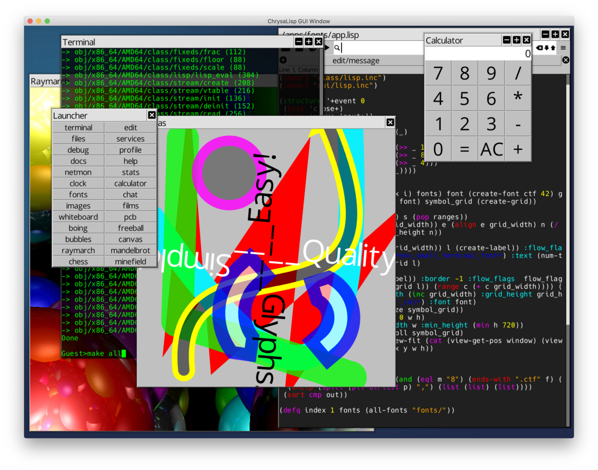
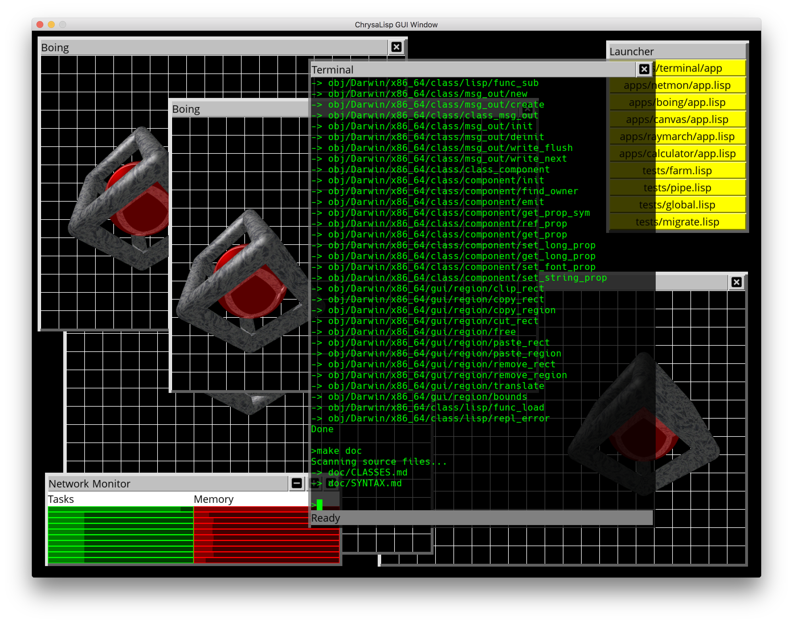
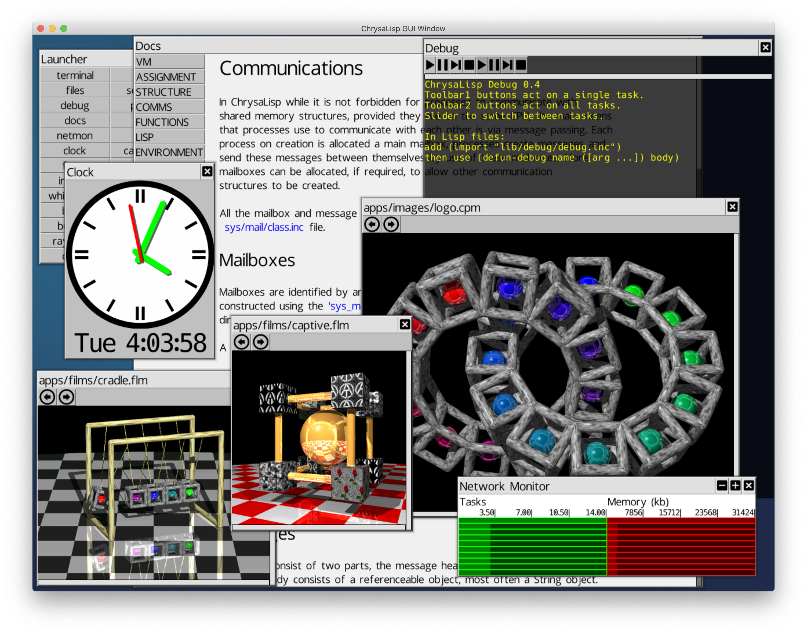
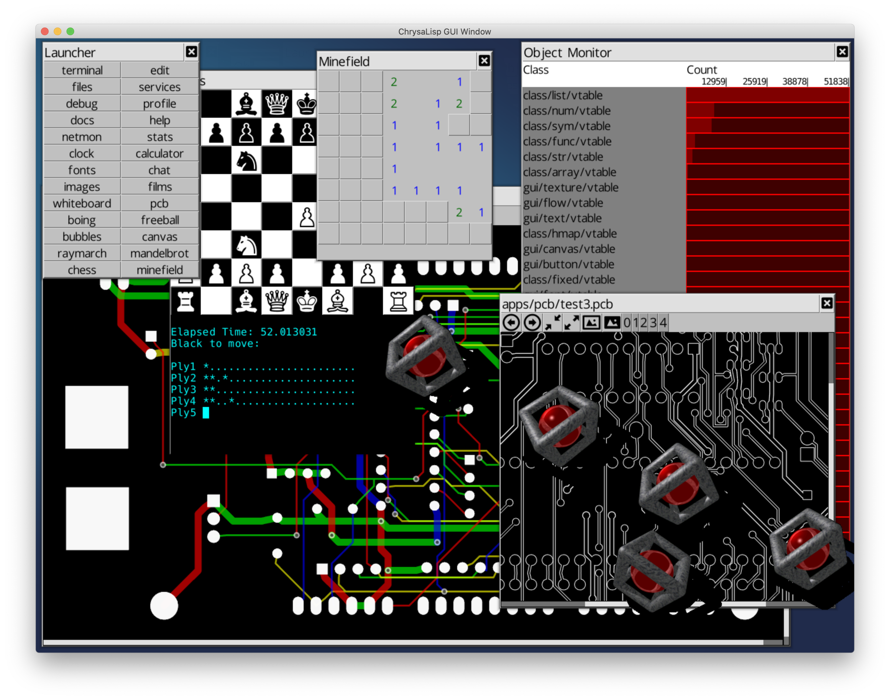
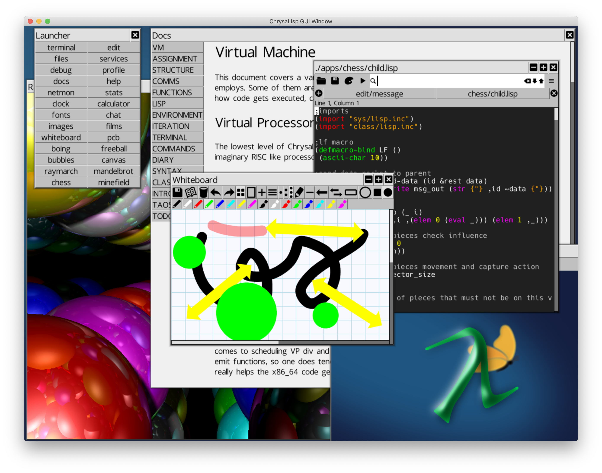
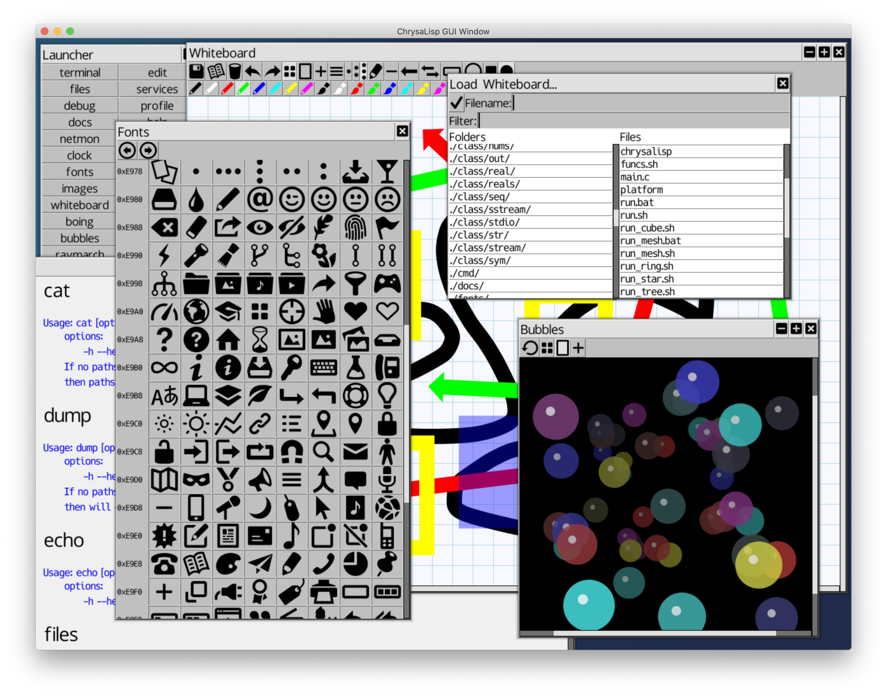
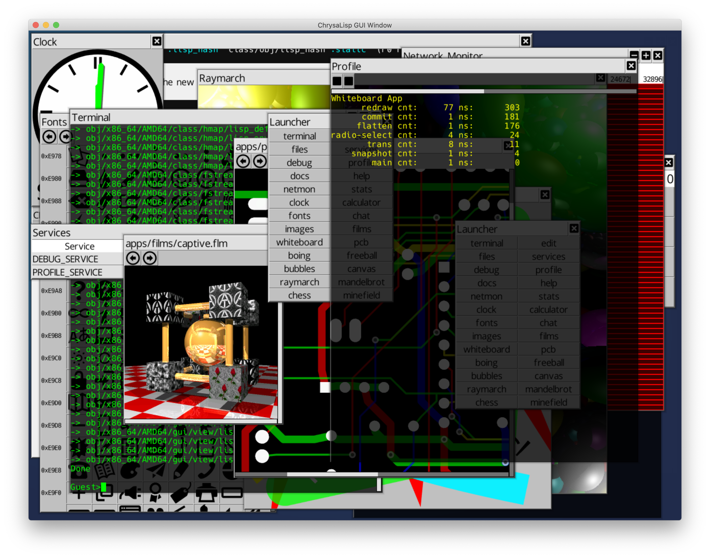
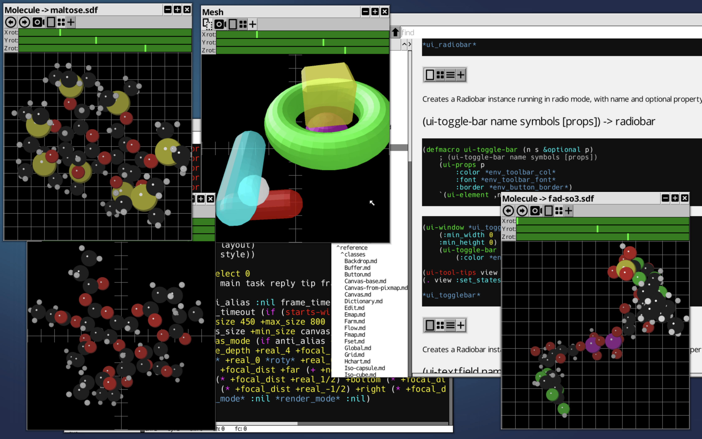
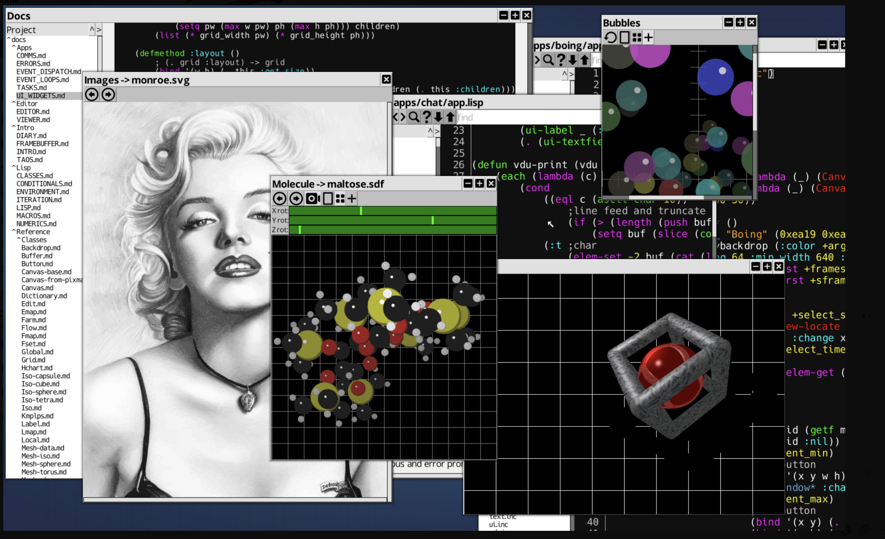

# ChrysaLisp

ChrysaLisp is a unique, 64-bit, MIMD operating system designed from the ground up for parallel and distributed computing. It's a complete, self-hosting environment featuring its own toolchain, a Virtual Processor (VP) for cross-platform portability, a responsive graphical user interface (GUI), a powerful command-line terminal with Unix-like pipes, an object-oriented assembler, extensive class libraries, a vpx compiler for efficient low-level coding, a unique Lisp interpreter, an integrated debugger and profiler, powerful programers editor, and vector font engine. Machines that run it find each other and join into one system, keep their files in step, and share a distributed object store. Its shader language draws the same picture on a GPU, or with none on every CPU of the network.



















## Demonstration Videos

Explore ChrysaLisp in action on our YouTube channel: [ChrysaLisp OS on YouTube](https://www.youtube.com/channel/UCp8kzLGrGC5BaAItw6-LnkQ)

Featured videos include:

* Installation, build process, and `make test` shorts.

* Demonstrations of the GUI environment and applications.

* Insights into the GUI compositor.

* A look at the integrated debugger.

## Key Features

* **Self-Hosting**: Includes its own assembler, Lisp interpreter, and build tools (`make`).

* **Virtual Processor (VP)**: A 64-bit RISC-like target ensuring portability across x64, ARM64, and RISC-V64, LA64, with a VP64 emulator for unsupported platforms or bootstrapping.

* **Parallel & Distributed**: Designed for MIMD architectures, supporting various network topologies simulated via shared memory links or linked directly across physical machines over native TCP networks.

* **Mesh Networking**: Machines on one network that hold the same key find each other and join into one system, with nothing to configure. Each end of a link proves it has the key before the link carries anything. `mesh` says who is there. See `docs/intro/mesh.md`.

* **Sync and Rack**: `sync` makes the files of another machine the same as this one's over those links, comparing a tree of hashes so that only what differs is sent, with no `ssh` or `rsync`. `rack "tests -a"` brings every machine level and runs a command on each of them. See `docs/ai_digest/sync.md` and `docs/ai_digest/rack.md`.

* **Storage** (new, in development): A distributed object store. An object is cut into blocks named by their SHA-256, each block is kept by several machines chosen by a hash that every member works out the same, and members compare notes and copy what is missing, so a machine can leave and come back. `(storage-stream path)` gives any object as an ordinary seekable stream, a block at a time with the next few on their way, and a "gopher", a small query task, can be sent to travel to the blocks and come back with an answer. The Storage app shows it working, a block at a time if you like. See `docs/ai_digest/storage_service.md`.

* **Dynamic Binding & Loading**: Functions are loaded and linked on demand, promoting efficient memory use and shared code among tasks.

* **Object-Oriented Assembler**: A powerful class system underpins the entire OS, from low-level assembly to high-level Lisp.

* **vpx Compiler**: Allows C-like expressions to be compiled into efficient VP code within Lisp.

* **Lisp Environment**: A unique Lisp interpreter for scripting, development, and system tasks.

* **Graphical User Interface**: A custom GUI system built using ChrysaLisp's own object model.

* **Shader Language and GPU**: Shaders are written as s-expressions and type checked in Lisp. One source goes to GLSL, to Metal, to SPIR-V for Vulkan, to native VP code that needs no GPU, and to a Lisp lambda the others are checked against. The SDL3 host draws shaders and lit meshes on the GPU, through Metal on a Mac and Vulkan on a Raspberry Pi. See `docs/ai_digest/shader_language.md` and `docs/intro/sdl3.md`.

* **Parallel Rendering**: With no GPU, a shader compiled to native code is drawn by the nodes of the network, a tile each. A canvas can keep its pixels in shared memory, and the Whiteboard has the nodes of a machine each draw a stripe of the same picture.

* **Whiteboard**: A board of shapes, not pixels, for many pointers at once, with instruments such as a ruler and a protractor that a pen runs along. A board is a `.cwb` text file that loads anywhere a picture does, and can be drawn by a hand, a script or an AI with the `cwb` command. The diagrams in the documentation are boards. See `docs/apps/whiteboard.md`.

* **Cryptography**: Native SHA-256, SHA-512, HMAC, ChaCha20 with Poly1305 and Ed25519 signatures, in `lib/crypto/`. See `docs/ai_digest/crypto.md`.

* **Network Stack**: URL, JSON and HTTP/1.1 libraries in `lib/net/`. See `docs/ai_digest/net_stack.md`.

* **Command Terminal**: A familiar pipe-style command-line interface.

* **Tests as a Cache**: Over 6,000 assertions in 140 modules. `tests` runs only the modules that stand on what has changed, so the test of a change is as big as the change. See `docs/ai_digest/test_cache.md`.

* **Source Checking**: `check`, `lint`, `forward`, `imports` and `includes` read the source and report faults the text alone can show, before anything is run.

## Supported Platforms

ChrysaLisp currently runs as a hosted environment on:

* macOS (x64, arm64)

* Windows (64-bit x64)

* Linux (x64, arm64, riscv64, la64)

    * Special support for Raspberry Pi (3/4, 64-bit OS) in framebuffer mode.

Future goals include bare-metal operation, UniKernel appliances, and a WebAssembly target.

## Quick Start Guide

This guide is for users familiar with command-line tools and build systems. For a more detailed, step-by-step walkthrough, please see the `docs/intro.md` document.

### 1. Download ChrysaLisp

* **Latest Release (Recommended)**:

  1. Go to [ChrysaLisp Releases](https://github.com/vygr/ChrysaLisp/releases).

  2. Download `ChrysaLisp-snapshot.zip`.

  3. Extract it. This contains source and pre-built VP64 boot image.

  *(or)*

* **Master Branch**:

  1. Ensure Git is installed.

  2. Clone:

```code
git clone https://github.com/vygr/ChrysaLisp.git
cd ChrysaLisp
```

### 2. Install Dependencies

The GUI is on SDL3. `make install` uses it if it is on the machine, and SDL2 if
it is not. See `docs/intro/sdl3.md` for a machine that has neither to hand, an
older Mac or Pi, and for what each gives you.

* **macOS**:

  * Xcode Command Line Tools: `xcode-select --install` (if needed).

  * SDL3: `brew install sdl3`

* **Linux (Debian/Ubuntu based)**:

  * Build tools: `sudo apt-get install build-essential git pkg-config`

  * SDL3: `sudo apt-get install libsdl3-dev`, where the release has it. To
    draw shaders on the GPU it has to be SDL 3.4 or later, which for now means
    building it from source, see `docs/intro/sdl3.md`.

  * Or SDL2: `sudo apt-get install libsdl2-dev libsdl2-mixer-dev`

* **Windows**:

  * Nothing to install, `install.bat` fetches `SDL3.dll`.

  * **macOS Cross-Compile**: To build Windows executables on macOS: `brew install mingw-w64` then `make -f Makefile.mingw windows_all`.

* **Raspberry Pi (Framebuffer mode)**:

  * Follow specific setup in `docs/framebuffer.md` or the comprehensive `docs/intro.md`.

### 3. Build and Install ChrysaLisp System

This process compiles the host C/C++ programs and then uses them with a pre-supplied VP64 boot image to compile the entire ChrysaLisp system into a native boot image.

* **macOS / Linux / Raspberry Pi (Desktop GUI mode)**:

```code
make install
```

* **Windows**:

```code
install.bat
```

* **Raspberry Pi (Framebuffer mode)**:

```code
make GUI=fb install
```

### 4. Run ChrysaLisp

* **Text User Interface (TUI)**:

  * macOS/Linux: `./run_tui.sh`

  * Windows Batch: `run_tui.bat`

  * Windows PowerShell: `.\run_tui.ps1`

* **Graphical User Interface (GUI)**:

  * macOS/Linux: `./run.sh`

  * Windows Batch: `run.bat`

  * Windows PowerShell: `.\run.ps1`

  * Raspberry Pi (Framebuffer): `./run.sh -f`

### 5. Using the Internal `make` Command

Once inside the ChrysaLisp TUI (Terminal app), you can rebuild the system:

* `make`: Compiles only necessary changes based on file modification times.

* `make all`: Recompiles all VP source files, regardless of modification times.

* `make boot`: Creates a new native boot image for the current platform.

* `make docs`: Generates reference documentation by scanning source files.

* `make platforms`: Compiles and builds for all supported target platforms, not just the host system. This includes creating boot images for each.

* `make it`: A comprehensive build that includes `all`, `boot`, `platforms`, and `docs`.

* `make vp`: Builds only the VP64 emulator's image.

* `make apps`: Builds only the apps, for all platforms.

* `release`, `debug`, `validate`: the mode to build in, with any of the above, as `make it validate` or `make vp release`. With none, `it` and `apps` build the VP64 in release and the rest in debug, `vp` builds it in debug, and the others build this platform in debug.

* `make test`: Runs internal timing tests for the make process.

You can combine options, for example: `make all platforms boot`.

### 6. Stopping ChrysaLisp

A session, the nodes one launch script started, stops itself. It lives while it has a terminal or a desktop open. Quit the last
desktop, or leave the TUI, and the rest of its nodes are stopped. Other
sessions on the machine are left alone. `nodes -g 1` opens another desktop.

To stop every node on the machine, whoever started it:

* macOS/Linux: `./stop.sh`

* Windows Batch: `stop.bat`

* Windows PowerShell: `.\stop.ps1`

## Advanced Features & Networking

ChrysaLisp's architecture supports sophisticated distributed computing paradigms. You can simulate various network topologies (ring, mesh, cube, star, tree) on a single machine, `./run.sh -t ring -n 8`, and add or remove networks of nodes while it runs with the `nodes` command.

### Joining machines: the mesh

Machines on the same network join by themselves if they have the same key, the file `mesh_key` in the ChrysaLisp folder. `make install` gives each machine its own. Copy one machine's key to the others and they find each other within seconds:

```code
mesh        ; who is there, and what to look at if nobody is
mesh -k     ; make a key, for a tree that has none
```

`docs/intro/mesh.md` is the guide. Once joined, every node of every machine sees the others: a build spreads over all their cores and the Network Map app shows the lot.

### Keeping machines in step: sync and rack

```code
sync -t all -c       ; what differs on the other machines
sync -t all          ; make them the same as this one
rack "tests -a"      ; make them the same, then run every test on each
```

### Storage (in development)

A store is shared by the machines of a mesh. Each machine that is a member keeps its part of it in a file of its own, and members find each other over the mesh.

A machine is not a member till it is told to be, once:

```code
storage -j
```

That makes this machine's part of the store, `storage/store.img` in the ChrysaLisp folder, and starts it. The store is the one of the mesh: its id is made from `mesh_key`, so every machine with the same key that has been joined is a member of the same store, with nothing else to say. From then on the store starts by itself whenever the machine is up, from a desktop or a terminal session alike.

*	**How big.** The file may hold up to 4GB, and takes only as much disk as is put in it. `storage -j -m 1024` makes one of 1GB. On a file system that can not leave holes in a file, a FAT or exFAT stick, it takes all of it at once.
*	**How many copies.** Each block is kept by three members, or by all of them when there are fewer. `-k` says another number.
*	**One at a time.** Only one session of a machine serves its store: the one that is the machine's member of the mesh. A second is told so.
*	**To stop.** `storage -x` stops it now. `storage -f` and it no longer starts by itself. The file is left as it is.
*	**Elsewhere.** `storage -s path` is `-j` with the file where you say, a disk of its own for one.

Then:

```code
storage                         ; what the store is, who its members are, what is in it
storage -p photo.png pics/photo ; put a file at a path
storage -g out.png pics/photo   ; and get it back, from whichever machines hold its blocks
storage -l pics/                ; what is there, and how many members have each
storage -P pics/                ; this machine holds all of what is under pics/, to take away
storage -T . tree/              ; put a whole folder, read it all back as streams and compare
```

From Lisp, `(storage-stream "pics/photo")` is a stream like any other, to read, and with `+file_open_write` or `+file_open_append` to write, as `(file-stream)` has it. The Storage app, under System in the launcher, shows a store at work.

### Linking by hand

The mesh is built on native TCP network linking (`service/net`) that allows you to link ChrysaLisp clusters directly across multiple physical machines (macOS, Linux, Windows, Raspberry Pi) over local LAN or wide area networks, without needing any external bridge daemons or shared memory hops.

To link machines together:

1. On the server machine, start a persistent listener:

```code
link -l 3333
```

2. On any client machine, connect to the server by IP address or DNS/mDNS hostname:

```code
link 192.168.1.185

# or using Bonjour / DNS:
link server.local
```

Alternatively, use zero-configuration LAN auto-discovery (`-a`):

1. On the server machine, listen and broadcast discovery beacons:

```code
link -l 3333 -a
```

2. On any client machine, automatically discover and connect to LAN peers:

```code
link -a
```

Both instances automatically discover each other's nodes, merge their routing tables, and distribute tasks and applications seamlessly across the combined compute cluster.

For detailed instructions on these advanced topics, please refer to the comprehensive `docs/intro/intro.md` guide.

## Clean and Snapshot

* **Clean**: To remove compiled object files and revert to the snapshot state:

```code
make clean
```

(This will require `unzip` to be installed).

* **Snapshot**: To create a distributable `snapshot.zip` containing only essential pre-compiled binaries and the VP64 boot image (primarily for developers maintaining the project):

```code
make snapshot
```

This is typically done after `make it` from within ChrysaLisp !
